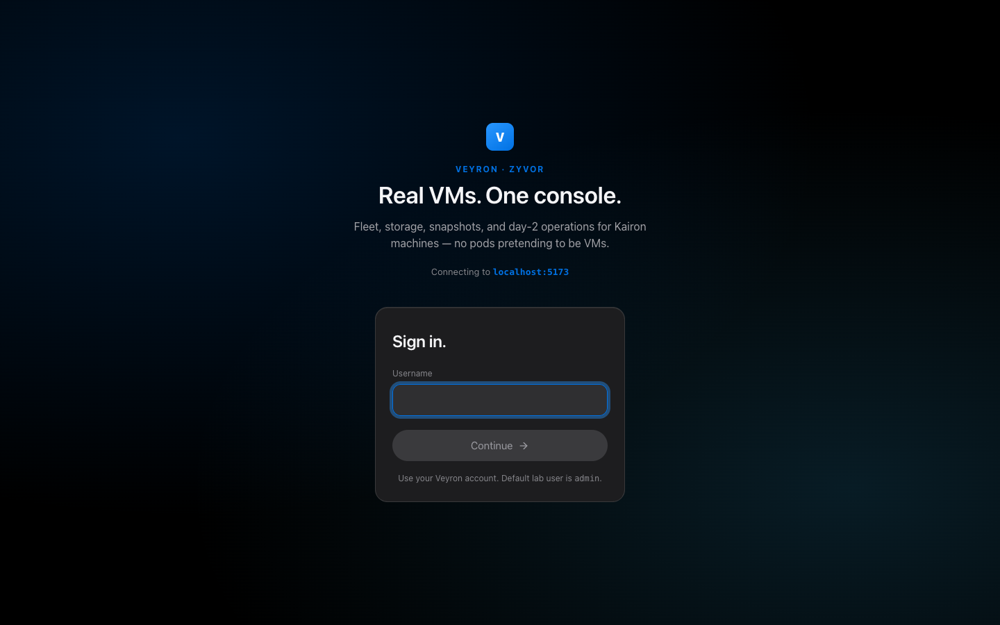

<!-- Copyright 2026 Zyvor AI Labs · https://zyvor.dev -->
<!-- SPDX-License-Identifier: LicenseRef-Zyvor-Production-1.0 -->
# Getting started

From an empty Kubernetes cluster to a running VM in the Veyron console.

## What you need

- A Kubernetes cluster (k3s works well) whose VM hosts are Linux with `/dev/kvm`.
- [Kairon](https://github.com/zyvorai/kairon) installed in `kairon-system`, with FluxVM on each VM host
  and an image cache on each node (`KAIRON_IMAGE_CACHE_DIR`, Helm `node.imageCacheDir`). Template
  disks and imported VMs download into it; without it they stop in `Error`.
- `kubectl` and `helm` on your workstation, and SSH access to one cluster node for the remote
  deploy script.

Check a host before you start:

```bash
./scripts/cluster/preflight-node.sh <host> <user>     # /dev/kvm, virt-host-validate, swap
```

## 1. Install Kairon

```bash
kubectl label node <vm-host> kairon.zyvor.dev/capable=true
helm upgrade --install kairon oci://ghcr.io/zyvorai/charts/kairon \
  -n kairon-system --create-namespace \
  --set node.imageCacheDir=/var/lib/fluxvm/images/cache
```

## 2. Deploy Veyron

The remote script syncs the source to a node, builds the images there and applies the manifests in
`veyron-system`:

```bash
./scripts/deploy-remote.sh <host> <user>
```

Or use the Helm chart in [`charts/veyron`](../charts/veyron) (see [deploy.md](deploy.md)). Mind the image
caveat there: `ghcr.io/zyvorai/veyron:0.4.1` (and `latest`) is published, but the GHCR package is private, so the cluster
needs pull credentials (`imagePullSecrets`; see [Container image](deploy.md#container-image)), or build from source with the
script above. The release binaries ([deploy.md](deploy.md#release-binaries), checksum-verified and cosign-signed checksums)
run the API and console outside the cluster.

For the browser console, guest commands and VM-state snapshots, Veyron talks to each node's
kairon-node relay. Give it the address template and token in an optional Secret. Keep `{node_ip}`
literal: Veyron replaces it per VM with that VM's node address, which matters as soon as you have
more than one node:

```bash
kubectl -n veyron-system create secret generic veyron-kairon \
  --from-literal=VEYRON_KAIRON_NODE_URL='http://{node_ip}:8090' \
  --from-literal=KAIRON_NODE_CONSOLE_TOKEN=<kairon-node console token>
kubectl -n veyron-system rollout restart deploy/veyron-api
```

`deploy/k8s.yaml` and the remote script load this Secret when it exists. The Helm chart does not: put the same
variables in a Secret and name it in `integrations.existingSecret` ([deploy.md](deploy.md#2-helm)).

## 3. Sign in

Open `https://<node-ip>:30151/console`. The certificate is self-signed on first deploy.



### Default credentials

| Field    | Value       |
|----------|-------------|
| Username | `admin`     |
| Password | `Admin@321` |
| API key  | `Admin@321` |

These are lab defaults, the same pair as [Netra](https://github.com/zyvorai/netra). The deploy
scripts and the Helm chart use them unless you override them:

- **Console password:** `VEYRON_BOOTSTRAP_ADMIN_PASSWORD` (Helm: `auth.adminPassword`), stored as
  `admin-password` in the `veyron-api-key` Secret.
- **API key:** `VEYRON_API_KEY` (Helm: `auth.apiKey`), stored as `api-key` in the same Secret.
- A redeploy keeps whatever the existing Secret holds, so a rotated key survives upgrades.
- The JWT signing secret (`VEYRON_JWT_SECRET`) is random. Console sign-in needs `VEYRON_JWT_SECRET` and
  `VEYRON_JWT_ISSUER`: without them `POST /api/v1/auth/login` answers `503 AUTH_NOT_CONFIGURED`.
- If `VEYRON_BOOTSTRAP_ADMIN_PASSWORD` is unset, the bootstrap `admin` password is the value of `VEYRON_API_KEY`
  (and `Admin@321` when neither is set). The account is only created when it does not exist yet; set
  `VEYRON_BOOTSTRAP_ADMIN_SYNC=1` to overwrite its password from the environment on every start (only when one of those
  two variables is set; the `Admin@321` fallback is never synced), `VEYRON_BOOTSTRAP_ADMIN_USER` to name the account
  something other than `admin`, or `VEYRON_BOOTSTRAP_ADMIN=0` to skip the bootstrap. The Helm chart sets sync to `1`.

The login screen shows the host you are connecting to ("Connecting to `<host>`"), so you can check
you are on the right cluster before signing in.

Change the defaults before anyone else can reach the console. Production setups add
role-scoped keys and SSO ([api.md](api.md), [sso.md](sso.md)). Local accounts and their roles are managed under
**Security → Users & roles** (admin only); deleting an account or resetting its password also ends its signed-in sessions.

## 4. Create a VM

In the console: **VMs → New VM**, pick a template (Ubuntu, Debian, Fedora, Windows and more), size
it and start it. Open the console tab for an in-browser VNC session (the VNC and serial consoles need a `write` or `admin` account; a
`readonly` account sees the VM but cannot open them). Click the VM's row for its
details panel: guest health, disks, snapshots and migrations. To snapshot it on a schedule, use
**Storage & Network → Snapshot schedules → New** with a cron such as `0 2 * * *` (UTC).

To install from your own ISO or boot your own disk image, upload it first under **Images → New →
Upload a file** (it lands in the Kairon image catalog), then choose it under **Boot from** when
creating the VM. See [windows.md](windows.md#installing-from-an-iso-on-kairon) and
[api.md](api.md#images-on-kairon-no-cdi).

The same through the API:

```bash
export VEYRON_API_KEY=Admin@321   # or your own key
curl -sk -H "X-API-Key: $VEYRON_API_KEY" -H 'Content-Type: application/json' \
  -X POST https://<node-ip>:30151/api/v1/vms \
  -d '{"name":"demo","namespace":"default","template":"ubuntu-24.04","cpus":2,"memory":"4Gi"}'
```

The `veyron` CLI's VM commands (`create`, `list`, `start`, `snapshot-*`, `tui`) work on KubeVirt
`VirtualMachine`s only in v0.4.1; they do not see Kairon Machines. On Kairon, use the console or the API.

## 5. Check the deployment

```bash
./scripts/verify-veyron-remote.sh <host>                          # API smoke test
VEYRON_API_KEY=<key> ./scripts/test-vm-daily-ops-remote.sh <host>  # VM lifecycle end to end
```

Next: [architecture.md](architecture.md) for how it works, [deploy.md](deploy.md) for production
settings, [migrate.md](migrate.md) to bring existing VMs over.
